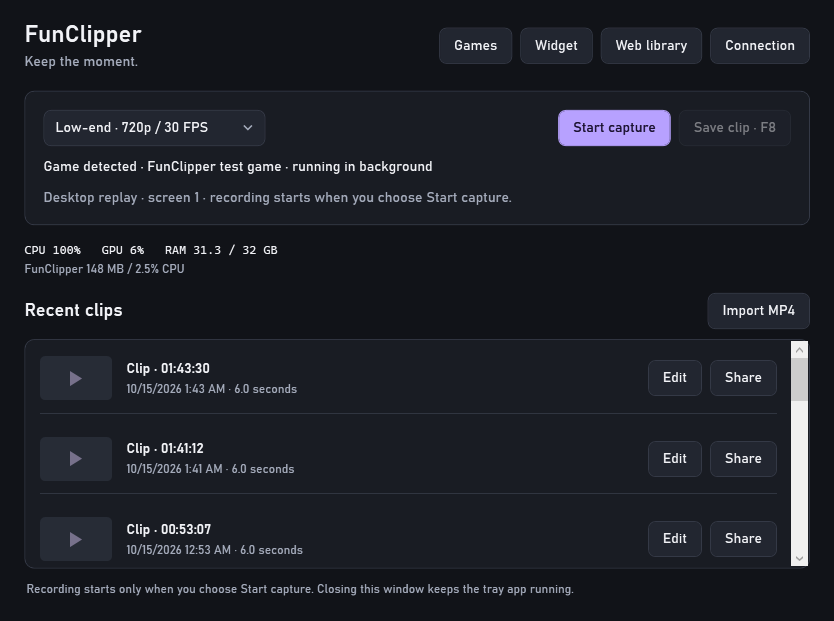
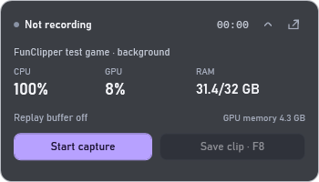
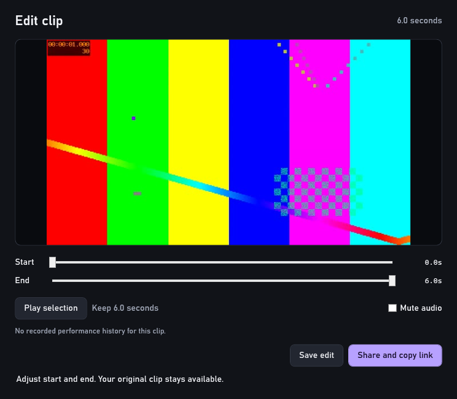
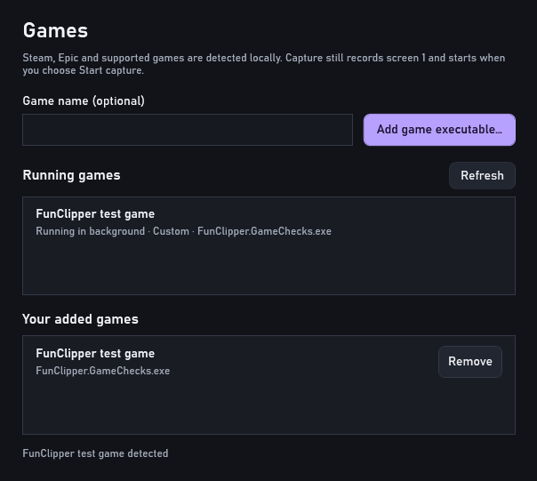
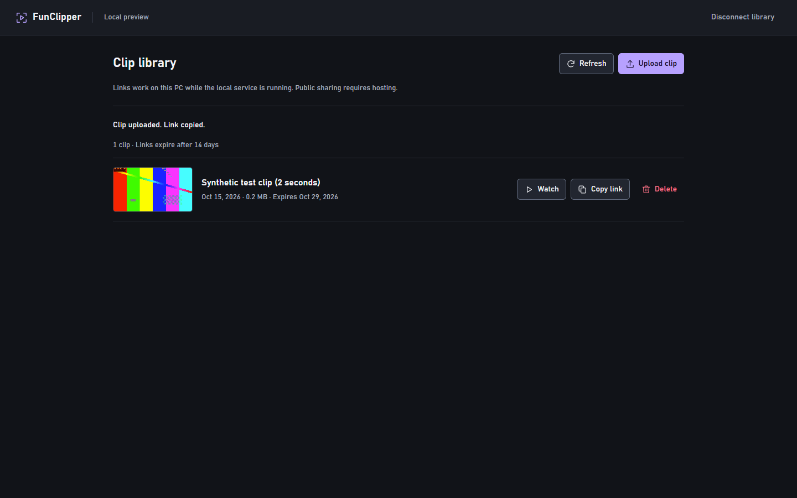
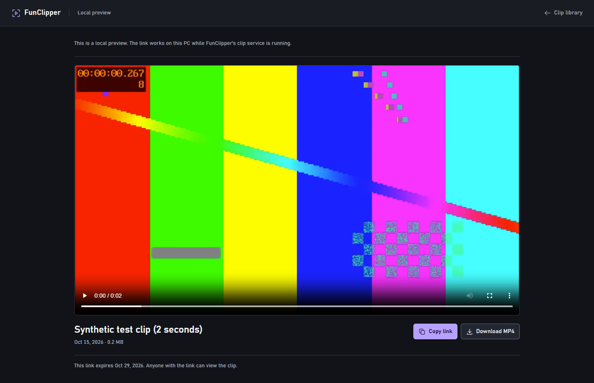
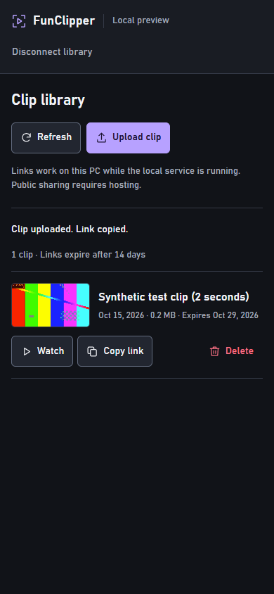

# FunClipper

A compact Windows replay recorder for saving recent footage, trimming it quickly, and sharing a clip link. Includes a floating recorder widget, actual CPU/GPU/RAM vitals, and a responsive web companion.

**Start capture → press F8 → trim or share.** Native WPF desktop, FFmpeg capture, and a plain HTML/CSS/JavaScript companion. This is a working local prototype; public sharing requires hosting.



## Showcase

### Floating recorder and PC vitals

Start or stop capture and save the replay from a translucent corner widget. Drag it between corners, adjust its opacity, or collapse it while playing.

| Expanded widget | Collapsed widget |
| --- | --- |
|  |  |

### Quick editing

Preview a clip, adjust its start and end, mute audio, and export or share. Original recordings remain available.



### Game detection

The active game appears in the app and widget. The Games panel lists running titles and lets you register an unsupported executable.



### Web library and clip viewer

Upload a finished MP4, copy its expiring link, and watch or download it. The library adapts to mobile screens.

| Clip library | Clip viewer |
| --- | --- |
|  |  |



These are captures of the running application with generated test footage. Vitals are sampled test-machine readings, not performance benchmarks. [Screenshot provenance](docs/screenshots/README.md).

## Features

- Hardware H.264 capture with AMD AMF, NVIDIA NVENC or Intel Quick Sync when available; an explicit two-thread CPU fallback in Minimum mode.
- Three recording profiles: 480p/30, 720p/30 and 1080p/60, with a bounded 15- or 30-second replay buffer.
- F8 replay saves while capture continues, plus tray and widget controls.
- Local game detection for Steam/Epic installs and supported executable names, with custom game registration and game labels on saved clips.
- WASAPI system audio, quick trim/mute export, and MP4 import.
- Real PC vitals, separate app/encoder resource costs, and saved performance history.
- Authenticated web library, range playback, expiring clip links and deletion.

## Run

On a fresh clone, install the prerequisites below, then run:

```powershell
.\scripts\Build.ps1
.\scripts\Start-FunClipper.ps1
```

After building, double-click **Start FunClipper.cmd** to launch again. The launcher also builds automatically if the published files are missing. It starts the web companion on localhost and opens the desktop app. Recording starts only when you choose **Start capture**. Choose a profile, press **F8** to save recent footage, then select **Edit** or **Share** directly from a clip row or the tray menu.

The editor previews a clip, trims its start/end, and can mute audio. **Share and copy link** prepares the edit, uploads it, and copies the finished link. An unchanged clip shares without another encode. You can import an MP4 without starting capture.

Closing the desktop window keeps the tray app running. Use the tray menu's **Stop capture** or **Quit**. `scripts/Stop-Web.ps1` stops the web companion started by the launcher.

The floating recording widget stays in a screen corner with CPU/GPU/RAM, elapsed capture time and the actual replay-buffer state. Start/stop and save directly from it. Drag its header to another corner, collapse it, or right-click for a corner, opacity or hide option; **Widget** and the tray menu restore it. It avoids taking game focus and asks Windows to exclude it from captured footage. Use borderless/windowed games for the overlay; exclusive fullscreen can cover ordinary desktop windows.

### Game detection

Open a game and FunClipper checks for it locally about every 2.5 seconds. The app and widget show the detected title. When several games run, the focused game takes priority; switching to the widget or another app retains the running game. Saved clips receive that game label, and trims keep it. After the game exits, its label is retained for one replay window, then later desktop-only clips have no game label.

**Games** shows running titles and your custom entries. If a game is missing, enter an optional name and choose **Add game executable…**. Use the actual game executable rather than its launcher. Remove deletes only that custom entry. **Refresh** rereads installed game libraries; they also refresh automatically every five minutes.

Detection uses local Steam/Epic manifests, a small list of known executable names and your custom entries. It performs no network lookup, injection or elevation. Generic Java processes, launchers and common helper/software processes are excluded; Java Minecraft and other unsupported titles may need custom registration. Detection is best-effort, particularly for protected processes or unlisted tools. It identifies running games and labels clips; capture still records the whole first display and starts only when you choose Start capture.

Prerequisites: Windows 10 or later, the .NET 10 SDK to build from source, the .NET 10 Desktop and ASP.NET runtimes to run the published apps, and FFmpeg/FFprobe with Desktop Duplication and the relevant H.264 encoder. Provide FFmpeg through PATH, `FUNCLIPPER_FFMPEG`, or the desktop's `tools/` folder. FFmpeg is not bundled. This repository contains source and showcase images; published binaries and recordings are generated locally.

## What works in this milestone

- Primary-display capture with hardware encoder probing, three quality profiles, and WASAPI system audio where supported. The display includes other open windows; this is not game-only capture. Microphone capture is not included.
- Bounded encoded replay segments, safe snapshots, MP4 saves while recording continues, and local exact trim/mute exports.
- Native CPU/RAM readings, supported Windows GPU counters, and separate desktop/encoder process costs. A bounded performance history is saved beside captured clips and summarized in the editor.
- Authenticated local upload/library, clean anonymous clip viewing, range playback, expiring links, and deletion.

Game FPS, frame times, temperatures, an injected in-game overlay, and automatic quality adaptation are pending. Unavailable readings are labeled; recording FPS is never displayed as game FPS.

## Sharing scope

The default links are **local previews**, usable only on this PC while the web companion runs. Hosting is required for friends to open them. The server folder includes a Dockerfile and an environment example; the desktop's **Connection** dialog accepts a hosted HTTPS origin and access key. Configuring a URL alone does not publish the service.

This prototype uses one private library. Public product deployment still needs account management, storage quotas, and operational controls. [Web configuration](src/FunClipper.Web/README.md) describes the API and current limits.

## Build and verify

```powershell
.\scripts\Build.ps1
dotnet run --project tests/FunClipper.CoreChecks
dotnet run --project tests/FunClipper.CoreChecks -- --metadata
dotnet run --project tests/FunClipper.GameChecks
dotnet run --project src/FunClipper.Desktop -- --smoke
```

Core checks use generated video/audio: they exercise trim correctness, source preservation, invalid bounds, process cancellation, bounded replay retention and snapshots, named-pipe ingestion, hardware encoding, hardware export, and child-process ownership. The desktop smoke renders the app offscreen with a synthetic clip and saves review images plus resource samples. It does not start recording.

The focused metadata check verifies game labels through replay save, catalog reload and trim, including older clips without a label. Game checks cover Steam/Epic parsing, helper/software exclusions, active-game selection and actual discovery/exit of an owned subprocess with temporary custom settings. After building GameChecks, append `--game-smoke` to the desktop smoke command to render the game UI with that controlled process; it does not run a commercial game or start screen/audio capture.

The web companion has isolated API/browser checks covering upload, playback, cancellation, clipboard recovery, authentication, deletion and mobile layouts. The native client also passed upload, viewer, range playback, and private-library access checks against an isolated service. See the web README for the API command.

The October 15 live recorder check captured an app-owned moving pattern at 720p/30 with AMD AMF and generated audio. It saved two independently decodable MP4s while the same capture process continued, verified increasing video timestamps and audio/video duration agreement, then checked stop/cleanup. The final run covered 95% of elapsed wall time on this loaded PC. Generated footage was deleted after validation; text diagnostics remain. This checks recorder behavior, not gameplay overhead or broad low-end support. Actual sound-device synchronization and long sessions still need measurement.

## Performance approach

The recorder stores compressed segments instead of raw frame history and uses bounded queues. Its interface opens on demand. When both the desktop and expanded widget are hidden and capture is stopped, vitals sampling stops. Otherwise vitals are sampled approximately once per second and their history is bounded to 120 samples; hidden graphs are not rendered. Capture, probes and exports use normal scheduling after low priority was observed to starve media jobs on this PC. Encoder/filter work remains bounded to two threads where applicable, with hardware encoding preferred. Frame timing preserves elapsed time and repeats frames when required instead of shortening the replay timeline.

Synthetic probing confirmed AMD AMF encoding and GPU resizing on the RX 6600 XT. The pipeline explicitly reports its frame copies; CPU resizing remains a fallback. Constant-frame-rate output normalizes repeated capture timestamps. No claim of zero game impact or broad low-end support has been established. [Benchmark plan and measured context](PERFORMANCE.md).

## REA investigation

REA is registered with Codex and its skill is installed. After the user restarted Codex, its MCP connection was verified and a public browser scenario was captured through MCP. The investigation also used the actual REA CLI against five public Medal website bundles and the official installer resource table. The installer was not executed, and the installed recorder code was unavailable.

[Findings and complete evidence references](research/medal-investigation.md) distinguish observed client syntax, inferences, and unknowns. [Investigate-Medal.ps1](scripts/Investigate-Medal.ps1) reproduces the public sample or analyzes an explicitly supplied local ASAR/tree. Medal's native capture architecture and performance are not established by that evidence.

## License

[MIT](LICENSE) © 2026 imranelak1.
